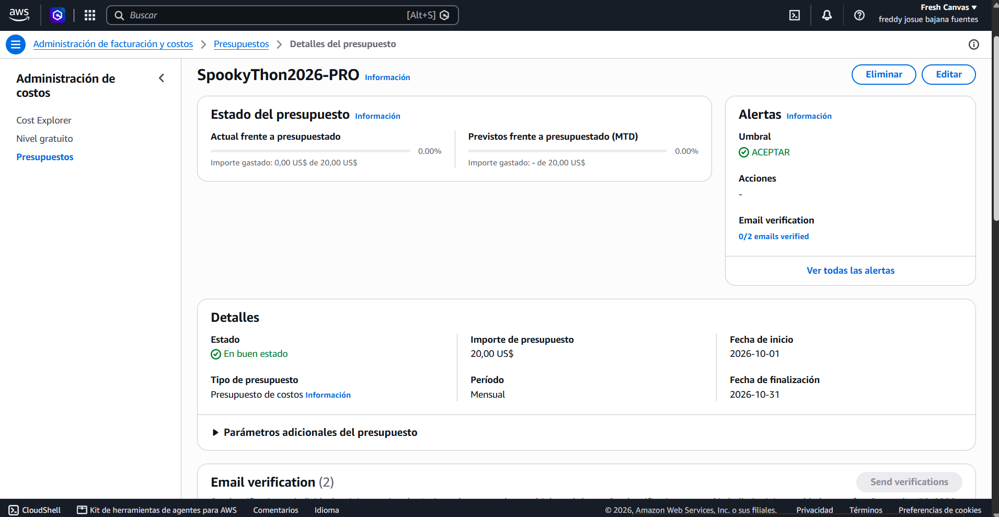
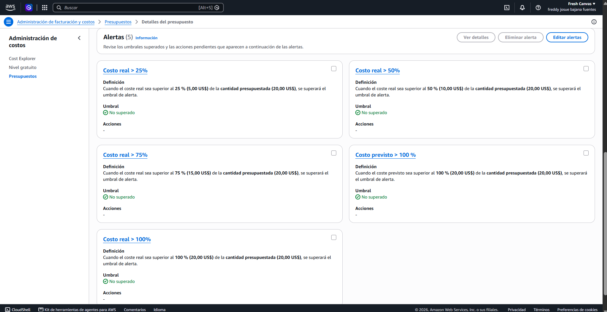

# Comité de Contención de Manta

Simulador de propagación y comparación de estrategias de contención sobre una población sintética.

Simulará una plaga SEIR sobre una población sintética inspirada en Manta y comparará vacunación estratégica con no intervenir y vacunar al azar, usando recursos limitados y experimentos reproducibles. Escenario educativo con parámetros del equipo.

**Estado:** especificaciones, entorno backend, contratos, normalizador de configuración, primitivas de reproducibilidad y experimentos SEIR con exportación y reproducción verificados localmente. El backend ejecuta y resume none/random/targeted, exporta JSON/CSV y reproduce el hash en otro proceso. Los cuatro handlers API están integrados y verificados localmente; la interfaz muestra preview, comparación y curvas reales y descarga el experimento JSON. La animación de una réplica representativa ya usa estados diarios reales y permite alternar estrategias. El inspector explica las selecciones de vacunas y muestra dosis efectivas/fallidas de la réplica. La red permite agrupación visual por barrio, hogar, colegio, bus o mercado y distribución circular. ZIP con CSV disponible para experimentos vigentes; despliegue pendiente.

## Documentación

- [PRD: alcance y aceptación](PRD.md).
- [TRD: arquitectura, contratos y metodología](TRD.md).
- [Especificaciones compartidas](specs/README.md): [requisitos](specs/requirements.md), [diseño](specs/design.md) y [tareas](specs/tasks.md).
- [Protocolo científico T-22 preparado](specs/validation/t22-v1/README.md).
- [Validación funcional del flujo local](docs/evidencia/validacion-flujo-local.md).
- [Revisión de cumplimiento de la base](docs/evidencia/revision-base.md).
- [Costos y evidencia pendiente](docs/costos.md).
- [Instalación y verificación del backend](backend/README.md).
- [Contratos de API y ejemplos para frontend/backend](schemas/README.md).

## Estructura

- `backend/src/`: dominio, simulación, estrategias y adaptadores HTTP.
- `backend/tests/`: pruebas del motor y contratos.
- `frontend/src/`: interfaz React/TypeScript con API, grafo, resultados y exportación reales.
- `schemas/`: contratos OpenAPI/JSON Schema y ejemplos mock.
- `infra/`: futura infraestructura AWS con Terraform.
- `scripts/`: reproducción/exportación, servidor API local y utilidades de entorno.
- `specs/`: especificaciones incrementales antes de implementar.
- `docs/evidencia/`: verificaciones locales y resultados observados.

Se adopta la separación backend/frontend del TRD. La carpeta local vacía `src/` no tiene contenido que versionar y no forma parte de la estructura acordada.

## Trabajo y siguiente incremento

Commits pequeños con mensajes en español y referencia RF/CA cuando corresponda. El comportamiento se desarrolla con TDD: prueba que falla, implementación mínima y refactorización; las verificaciones disponibles deben pasar antes de publicar.

Las interfaces están fijadas en [los acuerdos técnicos](specs/agreements.md). T-02..T-12 están verificados localmente; T-13..T-16 tienen integración real documentada en I-01..I-08, pero faltan criterios de aceptación. I-09 corrige la validación de preview y el consumo de configuración publicada. Por aclaración del responsable (2026-10-27), los casos del jurado se configuran manualmente; no hay presets fijos obligatorios. El siguiente trabajo es completar la validación integral y medir ese flujo (RF-15/CA-12). El protocolo T-22 v1 está preparado y congelado; su ejecución y resultado científico siguen pendientes, junto con infraestructura T-17/18 y despliegue T-19/20. Consulta la [revisión de base](docs/evidencia/revision-base.md) antes de declarar terminada una tarea.

## Parámetros previstos

| Parámetro | Valor | Procedencia |
|---|---:|---|
| Población | 1.000 | Supuesto del equipo |
| Horizonte | 90 días | Supuesto del equipo |
| Casos iniciales | 1 | Reto oficial |
| Réplicas | 30 | Supuesto del equipo |
| Vacunas | 100 | Supuesto del equipo |
| Día de intervención | 0 | Supuesto del equipo |
| Eficacia | 100 % | Supuesto del equipo |
| Incubación media | 3 días | Supuesto del equipo |
| Duración infecciosa media | 7 días | Supuesto del equipo |
| Semilla | 20261026 | Supuesto del equipo |

La configuración completa y las fórmulas están en el TRD. Estos valores ya permiten ejecutar localmente experimentos y resúmenes Monte Carlo; el gate científico de T-22 y el benchmark AWS siguen pendientes. No se afirma que la estrategia supere las líneas base hasta medirlo.

## AWS y pendientes técnicos

Región prevista según PRD/TRD: `us-east-2`; el enunciado menciona `us-east-1` por confirmar, por lo que se debe verificar la aceptación de Ohio con la organización antes de desplegar.

El diagrama lógico está en la sección 2 del TRD. Falta exportar el diagrama de entrega a SVG y conservar su fuente editable. También están pendientes la URL pública, resultados, benchmark y estimación mensual.

### AWS Budget — evidencia provisional

Presupuesto `SpookyThon2026-PRO` configurado por **USD 20 mensuales**, con umbrales de costo real al **25/50/75/100 %** y de costo previsto al **100 %**.

**Pendiente:** la captura muestra `0/2` destinatarios verificados. El envío de verificación está bloqueado por permisos de `notifications-contacts` en la experiencia simplificada de AWS; al intentar modificar el rol, la consola solicita activar características avanzadas. La recepción de notificaciones aún no está confirmada y el requisito de alerta operativa no se declara completado.

Las siguientes capturas documentan la configuración observada, no una consulta en tiempo real ni el gasto final del evento. No muestran las direcciones de correo de los destinatarios; la barra superior conserva el nombre visible del titular.

Una alerta de Budget no detiene automáticamente el gasto. Se actualizará la evidencia cuando se resuelva la verificación de destinatarios.

Todas las funciones PRO están **no iniciadas**. Se han ejecutado simulaciones y pruebas locales; la aplicación todavía no se ha desplegado en AWS.
