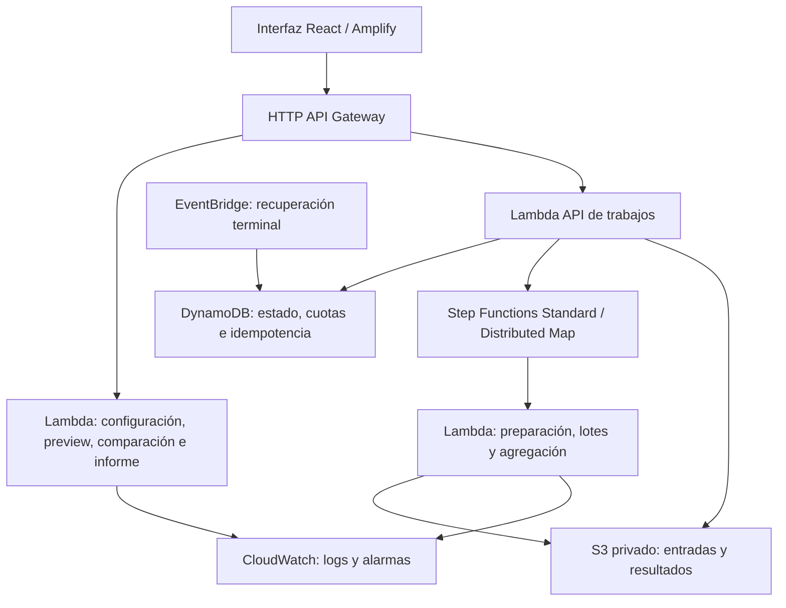

# Comité de Contención de Manta

Aplicación web educativa para explorar un brote ficticio de zombis en una población sintética inspirada en Manta. Permite configurar un modelo SEIR, observar la red y el mapa, comparar vacunación dirigida, aleatoria y ninguna intervención con los mismos recursos, y exportar resultados reproducibles e informes breves para alcaldía.

**Sitio AWS actual:** [abrir simulador](https://staging.d2uefmypgx02e9.amplifyapp.com/). Región `us-east-2` (Ohio). [Health API](https://n75ovr6vb5.execute-api.us-east-2.amazonaws.com/v1/health). Despliegue del 28/10/2026; [evidencia AWS y límites](docs/evidencia/despliegue-main-p04-2026-10-28.md). Las URLs pueden cambiar al recrear la infraestructura.

Es una simulación educativa: no predice epidemias reales ni usa pacientes o posiciones personales. El mapa OSM sirve de contexto visual. La estrategia dirigida puede ganar, empatar o perder; el informe conserva la incertidumbre.

## Qué incluye

- Configuración, preview de contactos multicapa y simulación diaria SEIR.
- Comparaciones pareadas de `none`, `random` y `targeted`; política adaptativa explicable, inventario, llegadas, capacidad y presupuesto educativo.
- Curvas, diferencias pareadas, conclusión de resultados y reproducción sincronizada de una réplica en red/mapa.
- Trabajos Monte Carlo, progreso, cancelación y descarga de resultados.
- Exportación JSON/ZIP/CSV, hash reproducible e informe PDF/HTML en lenguaje sencillo.
- Serie real provincial de dengue con procedencia documentada y un ajuste experimental etiquetado **«Ajustado, no validado»**. No equivale al brote ficticio ni demuestra riesgo de Manta.

## Ejecutar localmente

Requisitos: Git, Python **3.12**, uv y Node/npm. Dependencias fijadas en `backend/uv.lock` y `frontend/package-lock.json`. En PowerShell, desde la raíz:

```powershell
Push-Location backend
uv sync --locked --python 3.12
Pop-Location
Push-Location frontend
npm ci
Pop-Location
```

Si uv no está disponible, seguir la [instalación del backend](backend/README.md). Abrir dos terminales desde la raíz:

```powershell
backend/.venv/Scripts/python.exe scripts/serve_api.py
```

```powershell
cd frontend
npm run dev -- --host 127.0.0.1 --port 5174 --strictPort
```

Abrir [sitio local](http://127.0.0.1:5174/) y [health local](http://127.0.0.1:8000/v1/health). La configuración Vite local conecta la API en el puerto 8000. Para probar rápido: 60 personas, siete días y dos repeticiones; consultar red, comparar y revisar resultados. [Recorrido completo y errores esperados](docs/probar-local.md).

Los trabajos locales viven en memoria y se pierden al reiniciar la API. AWS usa almacenamiento durable con expiración. No se necesitan credenciales AWS para probar el motor y la interfaz local.

## Track B: parámetros y reproducción de resultados

**Semilla raíz por defecto: `20261026`** (`rootSeed`). La API publica la configuración vigente en `GET /v1/config`, campo `defaults`; la interfaz la carga al iniciar. El perfil AWS `staging-bounded-v1` reduce población y horizonte para respetar los límites de la API síncrona.

| Parámetro | Local por defecto | AWS staging por defecto |
|---|---|---|
| Población (`populationSize`) | 1000 | 200 |
| Horizonte (`days`) | 90 días | 20 días |
| Repeticiones (`repetitions`) | 30 | 30 |
| Semilla (`rootSeed`) | 20261026 | 20261026 |
| Red (`networkMode`) | `fixed` | `fixed` |
| Transmisión por contacto (`beta`) | 0.08 | 0.08 |
| Progresión E → I (`sigma`) | 0.333333 | 0.333333 |
| Recuperación I → R (`gamma`) | 0.142857 | 0.142857 |
| Infectados iniciales (`initialInfectious`) | 1 | 1 |
| Origen (`origin`) | `random`, valor `null` | `random`, valor `null` |
| Vacunas (`vaccines`) | 100 | 100 |
| Día de intervención (`interventionDay`) | 0 | 0 |
| Eficacia (`vaccineEfficacy`) | 1.0 | 1.0 |
| Políticas (`policies`) | `none`, `random`, `targeted` | `none`, `random`, `targeted` |
| Generador (`generatorVersion`) | `synthetic-manta-v1` | `synthetic-manta-v1` |
| Día cero (`dayZero`) | lunes (`monday`) | lunes (`monday`) |
| Pesos hogar/colegio/bus/mercado/barrio | 1.0 / 0.6 / 0.45 / 0.5 / 0.2 | iguales |

Los valores beta/sigma/gamma son parámetros diarios del modelo educativo. Por defecto no se añade un presupuesto monetario, calendario de llegadas, política adaptativa ni intervención combinada: si se activan, también deben conservarse en la configuración exportada. `fixed` reutiliza la red entre réplicas; las fuentes de aleatoriedad se derivan por dominio e índice y se emparejan entre políticas.

Para repetir la comparación inicial de AWS, iniciar una sesión sin configuración previa, comprobar estos valores, pulsar **Consultar red** y **Comparar estrategias**, y descargar el **JSON del experimento**. Para repetirla localmente, establecer explícitamente N=200/T=20 antes de consultar la red; los defaults locales N=1000/T=90 corresponden a otro experimento. La semilla se consulta/cambia en los parámetros avanzados.

Para reproducir exactamente un resultado guardado, conservar el JSON completo —no solo la semilla—, la revisión del código y las versiones de Python y dependencias indicadas en `manifest`. Con ese entorno instalado, desde la raíz:

```powershell
# Sustituir por la ruta del JSON descargado.
backend/.venv/Scripts/python.exe scripts/reproduce.py "C:/ruta/experiment.json"
```

El comando vuelve a ejecutar el experimento, verifica los resultados y muestra el mismo `manifest.experimentHash` si la reproducción es correcta; devuelve error ante un entorno incompatible o diferencias. El manifiesto incluye `pythonVersion` y `dependencies`: usar esas versiones exactas, no asumir que cualquier Python 3.12 produce un hash compatible. La prueba AWS registrada usó **Python 3.12.15**.

Como referencia adicional, la [prueba Monte Carlo AWS de 100 réplicas](docs/evidencia/despliegue-main-p04-2026-10-28.md) usó N=60, T=7, diez vacunas, intervención en día 0, un infectado inicial y semilla `20261026`; mantuvo los demás parámetros anteriores y produjo `sha256:af81a59752ecb3fc60f763ef38bc6b9fce5d7f1a0f1981cffd60f612191ba931`. Es un caso distinto del perfil inicial de 30 repeticiones. El protocolo científico T-22 conserva sus propias configuraciones y semillas en [su registro congelado](specs/validation/t22-v1/README.md).

## Cómo probar

Desde la raíz, con dependencias instaladas:

```powershell
Push-Location backend
.venv/Scripts/python.exe -m pytest -q
.venv/Scripts/python.exe -m ruff check src tests
.venv/Scripts/python.exe -m ruff format --check src tests
.venv/Scripts/python.exe -m mypy
Pop-Location
Push-Location frontend
npm test -- --run
npm run typecheck
npm run build
Pop-Location
backend/.venv/Scripts/python.exe scripts/check_validation_protocol.py
```

En Linux/macOS usar `.venv/bin/python`. Para aceptación funcional recorrer configuración → preview → comparación → reproducción → exportación → informe; probar también errores de conexión, presupuesto agotado y ausencia de susceptibles. [Plan de pruebas locales](docs/plan-pruebas-local.md).

El protocolo científico T-22 tiene [resultados y límites versionados](docs/evidencia/t22-v1-ejecucion.md); no reescribir semillas ni escenarios para mejorar resultados. La aceptación humana y una ejecución AWS de 1000 réplicas siguen siendo verificaciones independientes.

## Desplegar, retirar y volver a publicar

La infraestructura está en `infra/`, con Terraform, estado remoto privado/versionado en S3 y bloqueo nativo S3. Requiere AWS CLI con sesión autorizada, Terraform >=1.10 y permisos en la cuenta destino. Los comandos de aplicación crean recursos facturables.

1. Ejecutar las pruebas anteriores e iniciar sesión con `aws login`.
2. Preparar el estado remoto: conservar el bootstrap existente; para una cuenta nueva, seguir [infra/README.md](infra/README.md).
3. Empaquetar Lambda, inicializar Terraform y revisar el plan según [CICLO-DESPLIEGUE.md](infra/CICLO-DESPLIEGUE.md).
4. Para mantener los trabajos Monte Carlo habilitados, incluir **`enable_aws_jobs=true`** en el plan según [P04-OPERACION.md](infra/P04-OPERACION.md). El procedimiento base por sí solo los deja deshabilitados.
5. Aplicar el plan revisado, tomar los outputs actuales y compilar frontend con `VITE_API_BASE_URL`, `VITE_BUILD_COMMIT` y `VITE_SCHEMA_VERSION=1.0`; publicar con `scripts/deploy_amplify.py`.
6. Confirmar despliegue `SUCCEED`, health, preview/comparación y el flujo en navegador. Los lotes de trabajos consumen cuota y deben ejecutarse deliberadamente.

El frontend se compila localmente y se carga manualmente a Amplify; un push de Git no lo despliega automáticamente. No incluir secretos en variables Vite ni en artefactos versionados.

Para retirar, revisar y aplicar el plan de destrucción del stack de aplicación siguiendo la misma guía, conservando el bootstrap y el Budget. Se eliminan también artefactos del stack y logs; exportar antes cualquier evidencia necesaria. Para volver a publicar, repetir el procedimiento y usar los nuevos outputs. No borrar el estado remoto como método de retirada.

## Arquitectura y decisiones de diseño

Descargar diagrama actualizado: [PNG en alta resolución](docs/arquitectura-aws.png) · [SVG vectorial](docs/arquitectura-aws.svg).



- **Ciencia en backend:** Python/NumPy/NetworkX calculan SEIR, agregados, costos educativos y conclusiones; React presenta el contrato y evita duplicar fórmulas.
- **Comparación justa:** mismas semillas y recursos entre estrategias, transiciones simultáneas, hashes y manifiesto exportable. No se ocultan empates o pérdidas.
- **Operación por demanda:** API síncrona para escenarios pequeños y trabajos distribuidos para réplicas; sin servidores EC2, NAT Gateway ni modelos de lenguaje de pago.
- **Gasto contenido:** un trabajo AWS activo, dos workers simultáneos, lotes de cinco y tres admisiones nuevas por día UTC compartidas por el stack; retención limitada. Son controles operativos, no un techo monetario.
- **Presentación explicable:** inventario y decisiones observables, incertidumbre visible, exportación y mapa sintético separados de datos epidemiológicos reales.

Contratos y detalles: [PRD](PRD.md), [TRD](TRD.md), [diseño](specs/design.md), [OpenAPI y esquemas](schemas/README.md), [procedencia geográfica](docs/manta-geography.md).

## Limitaciones conocidas

- Staging usa un perfil inicial de 200 personas/20 días/30 repeticiones. El caso original 1000/90/30 no queda acreditado en la API síncrona AWS: puede exceder su timeout de 28 s.
- Monte Carlo AWS admite 2..1000 réplicas sujeto al máximo de 50 millones de arista-día-réplica. **100 réplicas verificadas en AWS; 1000 pendientes de ejecución real.** La cifra máxima no garantiza cualquier tamaño de red/horizonte.
- El sitio no autentica usuarios; las tres admisiones diarias son compartidas. Un visitante puede ocupar la cuota. No hay cuota monetaria individual ni garantía de disponibilidad pública ilimitada.
- Metadatos con expiración de 24 h y artefactos S3 con lifecycle de un día; limpieza física eventual. Enlaces firmados de cinco minutos; resultados limitados a 32 MiB descomprimidos.
- El preset dengue `manabi-dengue-2025-v1` pierde frente a persistencia en validación y conserva `fitted-not-validated`. Los datos son provinciales y preliminares; no permiten afirmar riesgo local real.
- La aceptación humana integral, evaluación táctil y algunos objetivos de rendimiento siguen pendientes. Las pruebas automatizadas no sustituyen esa aceptación.
- El Budget tiene alertas configuradas, pero las capturas muestran destinatarios pendientes de verificación; no se acredita recepción de avisos.

## Costos, gasto real y AWS Budget

**Estimación de planificación: USD 2,63/mes**, para 1000 visitas y diez trabajos de 1000 réplicas pequeñas (N60/T7), además del tráfico API indicado. Sin descontar créditos ni capa gratuita. Incluye Lambda, HTTP API, Amplify, Step Functions, S3, DynamoDB, logs, cinco alarmas y transferencia. [Supuestos, tarifas, cálculo visible y comando reproducible](docs/costos.md).

**Presupuesto del equipo: USD 20 desde el 26/10. Operación del despliegue actual: 28–30/10/2026.** La consulta del 28/10 a las 06:13 de Ecuador muestra **USD 0,00 provisional** para ese día en Cost Explorer, a nivel de cuenta y con `Estimated=true`. El gasto final 28–30 queda pendiente hasta terminar el período y actualizar la facturación; no se declara cero definitivo. [Lectura verificable](docs/evidencia/facturacion-2026-10-28.json) y [procedimiento de cierre](docs/costos.md#cómo-cerrar-el-gasto-después-del-30).

AWS Budget está configurado por **USD 20 mensuales** (octubre completo), con alertas reales al 25/50/75/100 % y prevista al 100 %. No detiene gasto. Estas capturas archivadas acreditan configuración, **no entrega de correo**: muestran 0/2 destinatarios verificados.


## Estructura y documentación

| Carpeta | Contenido |
|---|---|
| `backend/` | Motor, API, estrategias, exportación e informes; pruebas Python |
| `frontend/` | Interfaz React/TypeScript y pruebas |
| `infra/` | Terraform, bootstrap y guías de despliegue/retirada |
| `schemas/` y `specs/` | Contratos, requisitos, diseño y tareas |
| `scripts/` | Servidor local, empaquetado, reproducción, despliegue y verificaciones |
| `docs/evidencia/` | Resultados ejecutados y límites observados |

[Backlog técnico](specs/tasks.md) · [Hoja de ruta Monte Carlo y extensiones](specs/pro-roadmap.md) · [Feedback docente](docs/plan-feedback-docentes.md) · [Entrada para agentes](AGENTS.md).
