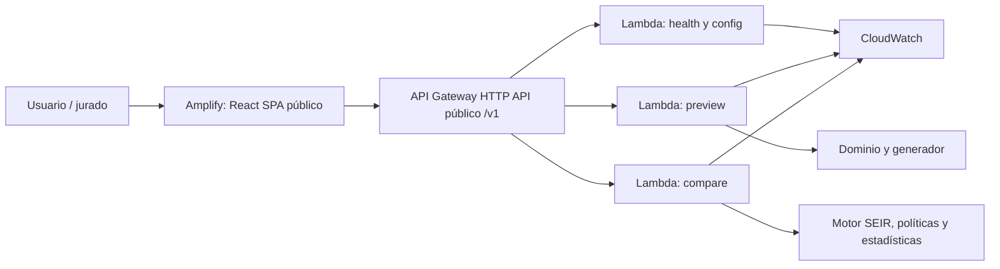

# Diseño de implementación — versión base

**Versión:** 1.0
**Fecha:** 26 de octubre de 2026
**Estado:** diseño adoptado y contratos estáticos T-03 verificados; funcionalidades pendientes.
**Fuentes:** [PRD](../PRD.md), [TRD](../TRD.md), [Requisitos](requirements.md).

## 1. Arquitectura y límites

Se conserva la arquitectura de TRD §1–3: Python 3.12, NumPy y NetworkX para motor; React, TypeScript y Vite con Cytoscape.js y Recharts para interfaz; Amplify Hosting, API Gateway HTTP API y Lambda para base. Versiones exactas y locks se incorporan al preparar cada entorno. No se agrega framework HTTP sin decisión documentada.



El navegador presenta resultados y descarga exportaciones; no recalcula el motor ni decide la política. Los handlers traducen HTTP a funciones de dominio sin dependencias AWS. La base no necesita base de datos. S3, DynamoDB y Step Functions quedan para PRO o un respaldo precomputado explícitamente etiquetado. El diagrama final de entrega debe exportarse también a SVG con fuente editable.

## 2. Módulos y propiedad compartida

| Directorio | Responsabilidad | Interfaz con otros equipos |
|---|---|---|
| `backend/src/domain/` | Tipos, configuración, validación, canonización y semillas | Modelos derivados del contrato compartido |
| `backend/src/simulation/` | Grafo, calendario, estado, transiciones, eventos, agregación | Entrada normalizada; resultado independiente de HTTP |
| `backend/src/strategies/` | Selección none/random/targeted y explicación | Snapshot de elegibles, red activa, recursos y RNG propio |
| `backend/src/api/` | Health/config/preview/compare y errores saneados | OpenAPI `/v1` |
| `backend/tests/` | Unitarias, propiedades, integración y contrato | Fixtures canónicos y evidencia de reproducción |
| `schemas/` | OpenAPI 3.1 y JSON Schema de request/result | Propiedad conjunta backend/frontend; cambios revisados por ambos |
| `frontend/src/` | Formularios, cliente HTTP, estados, vistas y exportación | Fixtures validados contra schemas; sin reglas epidemiológicas duplicadas |
| `infra/` | Terraform, parámetros de entorno, permisos, logs y alarmas | Rutas y nombres lógicos pactados con backend |
| `scripts/` | Reproducción CLI y verificaciones | Reutiliza motor y contratos; no implementa otra simulación |

## 3. Dominio y flujo de cálculo

Incremento T-11 (RF-19/20, CA-13/15 local): cuatro handlers payload v2 `api.health/config/preview/compare.handler`, rutas GET health/config y POST scenarios/preview/simulations/compare bajo /v1. Adapter común parsea JSON/base64 con límite antes del dominio, sanea errores, aplica límites de grafo/frames/JSON/envoltorio y comprime preview/compare con gzip mtime=0 + base64. CORS se delega a HTTP API. Versiones de entorno incompatibles o límites inválidos producen COMPUTE_UNAVAILABLE; MAX_RESPONSE_BYTES debe admitir al menos 1024 bytes para una respuesta de error. Compare verifica expectedGraphHash antes de simular y reutiliza el grafo generado. La salida se valida con schema y no devuelve éxito parcial. Pruebas de integración reales handler→motor→schema, errores de contrato/hash/límites/base64, fallo interno sin secretos y reproducción de compare. No incluye despliegue ni benchmark Lambda.

Incremento T-10 (RF-13/19, CA-06/07/11): `simulation.exports` completa resultado con manifiesto/versions reales, experimentHash no volátil y JSON validado. La proyección incluye configuration, graph, versions y réplicas (índice, IDs iniciales, randomnessHash y metrics/daily/selections por política); excluye hashes derivados, eventos/frames y metadatos volátiles. La reproducción exige entorno/versiones compatibles, verifica hashes y vuelve a ejecutar el motor; compara también campos derivados y eventos/frames presentes para detectar manipulación fuera del hash. Límite de importación/exportación JSON 32 MiB con lector estricto. `scripts/reproduce.py` verifica un JSON en otro proceso y sale no cero ante diferencia. `scripts/export_experiment.py` crea JSON/ZIP local, sin endpoint ni cambiar que el ZIP de la UI será generado por cliente en T-15. ZIP UTF-8 con columnas acordadas y exportMetadata solo en su manifest.json; no usa timestamps variables. Pruebas: schema CompareResponse real, roundtrip nuevo proceso sin frames, metadatos ignorados por hash, resultados/versión alterados rechazados, JSON duplicado/no finito, ZIP/CSV encabezados, null/listas/escapes y reproducibilidad de orden.

Incremento T-09 (CA-09/10): `simulation.experiments` calcula métricas desde trazas, estadísticas linear, diferencias pareadas y bootstrap compartido de 2.000 remuestras; selecciona representativa por distancia a mediana targeted/índice. `run_experiment` genera una red fija, procesa una réplica a la vez y conserva resultados compactos; reejecuta solo la representativa para eventos/frames. Devuelve datos de dominio, sin envoltorio HTTP/manifiesto de exportación T-10/11. Un fallo aborta con SIMULATION_FAILED 500 sin resumen parcial. Pruebas previstas: vectores conocidos, extinción E+I, primer pico, vacunados excluidos de acumulados, censura, diferencias negativas, recomendación gana/empata/pierde, bootstrap R<30/30 y aislamiento de orden/semillas. ResultHash cubre metrics/daily/selections. Terminado exige suite y evidencia observadas; no equivale al gate científico T-22.

Incremento T-08 (RF-05/06/12, CA-02/03/05/07): `strategies.vaccination` separa selección por snapshot de aplicación de eficacia. `select_candidates` solo recibe estados, aristas activas, recursos y RNG policy-random; no ve potenciales futuros. targeted suma pesos hacia S con math.fsum en orden estable y desempata por ID. contexts enumera contextos que contribuyen al score, ordenados; random conserva rank de muestreo aunque serialice por ID. `simulate_policy` reutiliza el motor T-07 y vacuna una única vez tras transiciones y antes del registro del día de intervención (también 0/T). `simulate_paired` valida las tres políticas, crea potenciales una sola vez por réplica y retorna trazas en orden canónico. Inventario en traza: assigned/effective/unused; none conserva K sin usar. Terminado: TDD, no elegibles, empate, K=0, K>elegibles, eficacia 0/1/parcial, dosis fallida consumida, frontera 0/T y orden invertido de políticas/réplicas. Métricas/agregación/HTTP se mantienen en T-09..11.

Incremento T-07 (RF-04, CA-01/04): `simulation.engine` genera potenciales por réplica con shapes transmission=(T,aristas), progression=(T,N,2), vaccine=(T+1,N), en orden C e independientes del consumo. `step_day` opera sobre un snapshot S/E/I/R, devuelve nuevo estado y eventos sin mutar entrada; transmisión por arista activa, causal menor edgeId y transiciones simultáneas. `simulate_none` ejecuta exclusivamente la referencia sin intervención, registra T+1 frames/conteos, acumulados y tiempos de entrada por nodo; no implementa aún políticas ni métricas agregadas T-08/09. randomnessHash enmarca cada matriz con longitud uint64 little-endian del encabezado JSON canónico `{name,shape}`, encabezado y bytes float64 little-endian, orden transmission/progression/vaccine. Pruebas previstas: conservación, R absorbente, fronteras 0/T, beta/pesos/tasas extremos, no transmisión secundaria ni progresión doble, causalidad mínima, calendario, shapes/RNG compartido y tres procesos. Terminado exige controles y evidencia real.

Incremento T-06 (RF-03, RNF-01/03): `simulation.network` ofrece `generate_graph(configuration, max_edges=100000)`, `select_initial(configuration, graph, replicate_index=0)` y `build_preview(configuration)` sin transporte HTTP. Genera exactamente D-03/04 con contactos hasta T inclusive. Orden de grupos: hogares, roles, salones, buses, vendedores, barrios; contactos fijos se crean al primer día y se reutilizan. Dentro de cada grupo se sortean candidatos ascendentes, después se conserva la permutación para agrupar; cada bloque se ordena para generar pares. Semilla NetworkX uint32 desde graph. Preview devuelve configuración, grafo/hash, posiciones y origen/hash; el envoltorio de versiones/requestId pertenece a T-11. initialStateHash cubre `{graphHash,initialInfectiousNodeIds}` antes de vacunas; cambios que producen idéntico estado conservan hash. Casos: domingo/lunes, cliques, pertenencias y roles, origen vacío/ID inválido, sin reemplazo, pesos, límite de aristas, layout excluido y tres procesos. No incluye transmisión ni endpoints.

Identidades estables: `NodeId=0..N−1`; estados `S/E/I/R`; contextos `household/school/bus/market/neighborhood`; políticas `none/random/targeted`. Nodo: id, rol, hogar, barrio y grupos. Arista: extremos, contexto y peso. Conservar capas distintas entre un par sin duplicar personas.

El generador sigue TRD §4.2: hogares con distribución acordada, roles 25/55/20 %, salones hasta 25 y grado objetivo 6, buses del 40 % de población hasta 40 por ruta, vendedores del 10 % de trabajadores, mercado grado objetivo 8, cinco barrios y probabilidad vecinal 0.02. Canonizar aristas por `(min(u,v), max(u,v), context)` antes del hash.

Pesos: hogar 1.00 todos los días; colegio 0.60 lunes–viernes; bus 0.45 y mercado 0.50 lunes–sábado; barrio 0.20 todos los días. Son supuestos, no estadísticas reales. El calendario y el muestreo están fijados en agreements.md §1–2.

Una comparación valida y normaliza configuración, crea la red fija, selecciona infectados iniciales por réplica y comparte condiciones externas entre políticas. Para origen por contexto sin candidatos devuelve `ORIGIN_EMPTY`; con varios infectados, el primero respeta origen y los restantes se eligen sin reemplazo.

La base aplica una intervención en `interventionDay`. Antes de la primera intervención las políticas tienen igual snapshot elegible. La ejecución usa:

```text
p_exposure(v,d) = 1 - product(1 - clamp(beta * weight(edge) * activity(context,d), 0, 1))
targetedScore(v) = suma de pesos activos hacia vecinos S
budget = min(vaccines, cantidad de elegibles S)
```

`none` no selecciona; `random` muestrea uniformemente sin reemplazo; `targeted` ordena score descendente e id ascendente. Devolver nodeId, score, rank, stateAtDecision, contextos y desempate. Un sorteo de eficacia exitoso hace S→R; uno fallido consume dosis sin cambiar S. Nunca se vacuna E/I/R ni se consulta aleatoriedad futura.

El motor respeta TRD §5.3: snapshot inicial, recursos/intervención, actividad, exposiciones, progresión desde snapshot y aplicación simultánea. R es absorbente. El día 0 contiene inicialización y vacunación si corresponde; primera transmisión produce día 1. Registrar T+1 conteos, eventos y tiempos de transición. La frontera de intervención y sus ejemplos están fijados en agreements.md §1.

## 4. Aleatoriedad, métricas y reproducción

Incremento T-05 (CA-06/07): `domain.reproducibility` expone `seed_entropy(root_seed, domain, replicate_index=0)`, `create_rng(...)`, `canonical_json(value)` (bytes UTF-8) y `json_hash(value)` (sha256 hexadecimal con prefijo). Acepta únicamente árboles JSON con claves string, rechaza números no finitos y no modifica entradas. Conserva orden de listas: cada productor debe ordenar entidades/días/réplicas según el contrato. No elimina campos automáticamente; el productor construye la proyección no volátil antes de llamar al hash. Grafo, matrices, resultados y manifiesto se conectan en T-06..11; este incremento no fabrica resultados. Pruebas: vector conocido SHA-256, derivación independiente SHA-256/PCG64, dominios/índices aislados y tres procesos con PYTHONHASHSEED distinto. Raíz uint32 e índice entero no negativo, sin booleanos; graph/layout/bootstrap fuerzan índice 0. Terminado exige suite y controles aprobados y evidencia registrada.

Usar `numpy.random.Generator` y `SeedSequence` con dominios separados `graph`, `initial`, `transmission`, `progression`, `vaccine`, `policy-random`, `layout`, `bootstrap`. Derivar etiquetas mediante UTF-8/SHA-256 junto a raíz e índice; no usar `hash()` ni RNG global. El mapeo exacto y PCG64 se fijan en agreements.md §3; convertirlos en fixtures al implementar.

Cada réplica comparte potenciales entre políticas; eficacia se indexa por réplica/día/nodo, sin depender del orden de selección. Procesar una réplica a la vez y separar layout de epidemiología. `networkMode=fixed` condiciona la incertidumbre a la red fija. La exposición ocurre cuando alguna arista tiene éxito, sin sorteo agregado adicional, según agreements.md §3.

Acumulados cuentan quien entró a E o inició en I; R vacunado no cuenta como infectado. `peakDay` es el primer argmax de I; finales usan I[T]. Personas salvadas = acumulados none − acumulados política; ganancia = acumulados random − acumulados targeted. Conservar valores negativos.

Agregación: media, mediana y P05/P95; bootstrap pareado 95 % con 2.000 remuestras para R≥30. Réplica visual: acumulados targeted más cercanos a mediana, desempate por menor índice. La duración exige extinción E+I=0 y los percentiles usan linear, según agreements.md §1/3.

El manifiesto incluye configuración, raíz/derivación, bitGenerator, networkMode, versiones Python/dependencias/motor/schema, commit, grafo y hashes por réplica/política. Canonizar UTF-8 y claves ordenadas con números normalizados; excluir timestamps/requestId del hash. El JSON debe reproducir el experimento en otro proceso con entorno fijado; CSV debe conservar identificadores para relacionar métricas, curvas y réplicas. Los archivos y columnas del exportador están fijados en agreements.md §6.

## 5. Contrato HTTP compartido

| Endpoint | Entrada / salida de éxito |
|---|---|
| `GET /v1/health` | Sin simulación; 200 con estado, versiones y región |
| `GET /v1/config` | 200 con defaults, límites efectivos y features |
| `POST /v1/scenarios/preview` | Configuración; 200 con normalización, grafo, posiciones y graphHash |
| `POST /v1/simulations/compare` | Experimento y hash esperado; 200 con comparación completa |

Ejemplo **parcial e ilustrativo** de configuración, con defaults del TRD; no es aún fixture ejecutable ni request completo de compare:

```json
{
  "schemaVersion": "1.0",
  "configuration": {
    "rootSeed": 20261026,
    "networkMode": "fixed",
    "repetitions": 30,
    "scenario": {
      "populationSize": 1000,
      "days": 90,
      "beta": 0.08,
      "sigma": 0.333333,
      "gamma": 0.142857,
      "initialInfectious": 1,
      "origin": {
        "kind": "random",
        "value": null
      }
    },
    "intervention": {
      "vaccines": 100,
      "interventionDay": 0,
      "vaccineEfficacy": 1.0
    },
    "policies": [
      "none",
      "random",
      "targeted"
    ],
    "network": {
      "generatorVersion": "synthetic-manta-v1",
      "dayZero": "monday",
      "weights": {
        "household": 1.0,
        "school": 0.6,
        "bus": 0.45,
        "market": 0.5,
        "neighborhood": 0.2
      }
    }
  }
}
```

Agreements.md §4 fija configuration.networkMode, configuration.network y la entrada exacta de preview; compare recibe `expectedGraphHash` real obtenido del preview, nunca `sha256:...` como valor válido. Cambiar campos de generación invalida preview; verificar hash en backend y rechazar discrepancia con 409. El ejemplo de TRD §9.2 usa origen mercado; el default de §4.3 es aleatorio, como arriba.

Respuesta de compare: configuración normalizada, manifiesto/hashes, `summaryByPolicy`, `pairedComparisons`, curvas agregadas, resultados por réplica, frames solo de representativa si se solicitan y recomendación con `winner`, `confidence`, `reasons`, `limitations`. Sus subcampos/tipos están fijados en agreements.md §5 y deben trasladarse a OpenAPI antes de integrar. No generar datos de éxito ficticios como evidencia científica.

JSON UTF-8, camelCase y enums minúsculos. Todas las respuestas, también los errores, incluyen schemaVersion/engineVersion/requestId; el ejemplo del TRD ya se alineó. Errores siguen envoltorio `error.code/message/fields[{path,reason}]`: 400 JSON/campo desconocido, 404 recurso, 409 hash/estado, 413 tamaño, 422 regla de valor, 429 admisión, 500 saneado y 503 cómputo cerrado. Usar los códigos estables de agreements.md §5 y convertirlos en ejemplos para cada ruta; sin stack traces ni secretos.

## 6. Frontend y coordinación

Integración incremental I-01: servidor de desarrollo `scripts/serve_api.py` en 127.0.0.1:8000 que traduce HTTP a eventos v2 y devuelve bytes reales (incluido gzip) de los cuatro handlers. Sin CORS wildcard ni servidor de producción; Vite proxy /v1 mantiene mismo origen. Entrada acotada a 64 KiB, errores y límites pertenecen al adapter existente. Prueba HTTP real health/preview/error en puerto efímero antes de implementar. Cierre independiente con commit y push antes de conectar la interfaz.

Pantallas: configurar → preview → ejecutar → comparar → sorpresa → exportar. Estados: idle, validating, previewing, ready, running, partial, succeeded, failed y cancelled (cancelación de trabajo pertenece a PRO). Conservar valores ante fallos; invalidar resultados al cambiar configuración y evitar mostrar respuesta antigua como resultado del escenario actual.

En base, HTTP síncrono no transmite avance por réplica: mostrar ejecución indeterminada y conteos reales al terminar. No fingir porcentaje ni añadir polling de jobs PRO. Si se necesita progreso vivo, acordar cambio de contrato/arquitectura antes.

Curvas S/E/I/R, bandas P05–P95 etiquetadas como rango, tabla y explicación de resultado; controles accesibles, leyenda con letras/iconos y foco visible. Frontend puede comenzar con fixtures consensuados y validados por schemas después de cerrar contrato, aunque motor siga pendiente. No usar esos fixtures como resultado real del sistema.

Presets sobre copia de base: beta=min(1,2*beta), vacunas=floor(K/2), origen mercado y eficacia=0.5. `late_intervention=7` está en TRD como adicional, no sustituye los cuatro obligatorios. Conservar hashes y diferencias base/sorpresa. No implementar reglas científicas distintas en UI.

## 7. Infraestructura y operación

La infraestructura se declara en `infra/` con `main.tf`, `variables.tf`, `outputs.tf` y `versions.tf`. Fijar versiones de Terraform/proveedores y versionar `.terraform.lock.hcl`. La configuración cubre los servicios base y su integración con Amplify; documentar cualquier configuración manual pendiente.

El frente de infraestructura define el backend de estado y bloqueo por entorno antes de aplicar cambios compartidos. No versionar estado, planes guardados ni variables con secretos. El pipeline empaqueta el código Lambda por separado y entrega a Terraform el artefacto y su hash; Terraform administra recursos, no sustituye las pruebas o el build de aplicación. Revisar `terraform plan` antes de `terraform apply`; registrar salidas públicas como URL API/frontend sin publicar credenciales.

Terraform configura Lambda, HTTP API, permisos mínimos, retención de logs, concurrencia/admisión y CORS por origen. Amplify sirve frontend. Región documental `us-east-2`; confirmar aceptación del reto y viabilidad de cuenta antes de provisionar. Registrar commit/build y variables de despliegue sin credenciales. Revisar disponibilidad, cuotas y tarifas en fuentes oficiales al implementar, no asumirlas por estas specs.

Objetivos: backend ≤25 s; total base p95 ≤60 s; sorpresa humana <5 min. Benchmark de TRD: N={500,1000,2000}, R={2,10,30}, T=90 y 20 ejecuciones base en staging; registrar memoria, CPU, duración y tamaño. Si no cabe en síncrono, documentar medición y revisar arquitectura antes de prometer fallback: el flujo asíncrono es PRO y aún no existe.

Logs JSON con requestId, versión, fase, N, aristas, R, duración, estado y error; sin grafos, tokens ni semillas como dimensión. Alarmas de errores/duración; alarma Step Functions solo si PRO se implementa. Pipeline: locks, lint/tipos, pruebas/build, schemas/OpenAPI/Terraform, secretos, staging y smoke; promoción manual. La planificación no autoriza despliegue ni cambio de plan AWS.

## 8. Estrategia de pruebas

TDD para comportamiento: ejecutar rojo por funcionalidad ausente, verde mínimo y refactor; guardar comando/resultado observado. Publicar commits en español con verificaciones disponibles pasando. Para estos documentos, revisar coherencia, enlaces y trazabilidad sin inventar tests ejecutables.

Unitarias: configuración, riesgo, transiciones, elegibilidad, ranking, semillas y métricas. Propiedades: conservación, monotonía de acumulados, límites y absorbencia. Integración: handlers+motor+schemas. Contrato: ejemplos y respuestas contra schemas. E2E: configurar, corregir error, ejecutar, sorpresa y exportar. Reproducción: tres procesos, políticas/réplicas reordenadas y JSON reimportado. Infra: Terraform, IAM, secretos y smoke público. Performance y usabilidad requieren medición real.

## 9. Decisiones adoptadas y comprobaciones externas

El contrato normativo completo está en [agreements.md](agreements.md): calendario, generación, sorteos, respuestas, CSV, canonización e interfaz Terraform. Sus decisiones concretan las descripciones de las secciones anteriores y sustituyen las menciones de detalle pendiente. OpenAPI/JSON Schema y los ejemplos ya están verificados en T-03; consultar schemas/README.md. La implementación de handlers y dominio sigue pendiente.

| ID | Punto no cerrado por los documentos | Responsable y momento |
|---|---|---|
| D-01 | Resuelto: formas HTTP, winner/confidence, CSV, canonización y límites iniciales | Acuerdos §4–6; contratos estáticos verificados en T-03 |
| D-02 | Resuelto: sorteos por arista, exposición si alguna tuvo éxito | Acuerdos §3; implementar en T-07 |
| D-03 | Resuelto: lunes día 0, contactos diarios, redondeos y reconexión 0.1 | Acuerdos §1–2; implementar en T-06 |
| D-04 | Resuelto: configuration.network, origen node entero y null en demás casos | Acuerdos §4; esquema verificado en T-03 y normalizador pendiente en T-04 |
| D-05 | Resuelto: estado registrado tras intervención; extinción exige E+I=0 | Acuerdos §1; implementar en T-07/09 |
| D-06 | Resuelto: PCG64/entropy, percentiles linear, bootstrap pareado y canonical-v1 | Acuerdos §3/6; implementar en T-05/09 |
| D-07 | Resuelto: error con engineVersion, exportación y selección trazables | Acuerdos §5–6; esquema verificado en T-03, exportador/handlers pendientes en T-10/11 |
| D-08 | Diseño resuelto: ZIP Linux, handlers, variables/outputs y estado Terraform S3; cuenta/región/Budget requieren comprobación externa | Acuerdos §7–8; comprobar en T-17 antes de desplegar |

Los ejemplos de aceptación del anexo deben convertirse en pruebas TDD por módulo. No se marca implementación completa por haber decidido su contrato.
