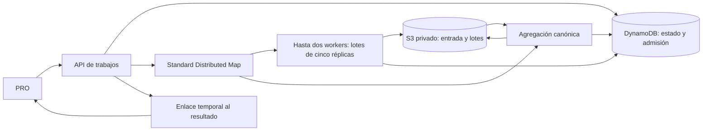

# P-04 — trabajos duraderos AWS

Implementación prevista, no evidencia de despliegue. Se conserva el sitio retirado.

Actualización: código, contratos, cliente y Terraform implementados y probados
localmente. [Evidencia](../docs/evidencia/p04-implementacion-local-2026-10-28.md).
La aceptación AWS permanece pendiente; no hay ejecución distribuida desplegada.

## Aceptación

- Igual configuración/semilla e índices globales: lotes desordenados deben producir
  el mismo experimento que `run_experiment`, incluyendo bootstrap y representativa.
- Standard Distributed Map, máximo dos trabajadores y un trabajo activo por stack.
- 2..1000 réplicas; máximo 50 millones arista-día-réplica; rechazo antes de iniciar.
  Una réplica incluye las tres políticas pareadas. No son 1000 funciones simultáneas.
- S3 privado para entrada, lotes y resultado; no pasar experimentos por Step Functions.
- DynamoDB: clave de trabajo/capacidad, bloqueo global e idempotencia. Sin Scan.
  Lecturas consistentes; expiración comprobada por aplicación, TTL solo limpieza.
- Reintentos deterministas: mismo índice global y clave S3; progreso cuenta lotes
  confirmados una vez. La agregación exige todos los índices, nunca oculta fallos.
- Cancelación terminal: no publicar resultados después de cancelar. Los trabajadores
  comprueban estado entre réplicas. Fallos liberan el bloqueo global.
- Resultado por URL S3 firmada breve; cliente conserva validación del documento.
- No lanzar miles de réplicas ni publicar recursos como efecto de pruebas locales.

## Presupuesto y límites

Una ejecución activa, hasta dos workers, lotes pequeños, timeout y reintentos
limitados, retención S3 de un día y TTL de metadatos. Estas medidas limitan carga,
no garantizan un importe monetario. Budget observado USD20, notificación no verificada.
Requiere medir 100 réplicas antes de autorizar una prueba AWS de 1000.

## Compatibilidad

P-03 local mantiene 2..100 y semántica actual. AWS anuncia capacidades reales.
La comparación síncrona mantiene su límite 30 y su perfil acotado. No editar T-22
ni cambiar semillas, motor SEIR o definición de targeted.
